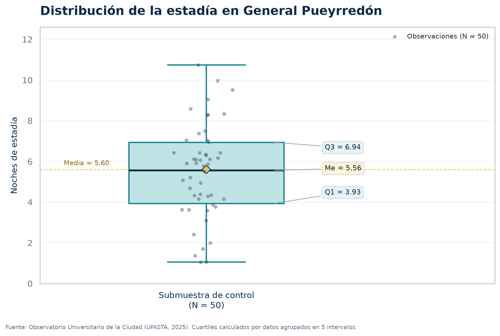
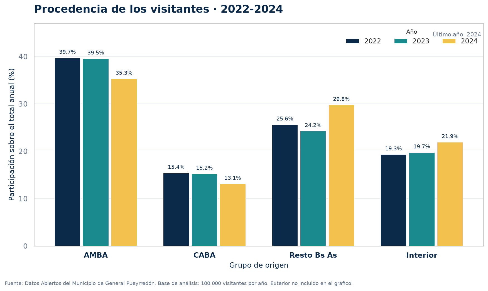
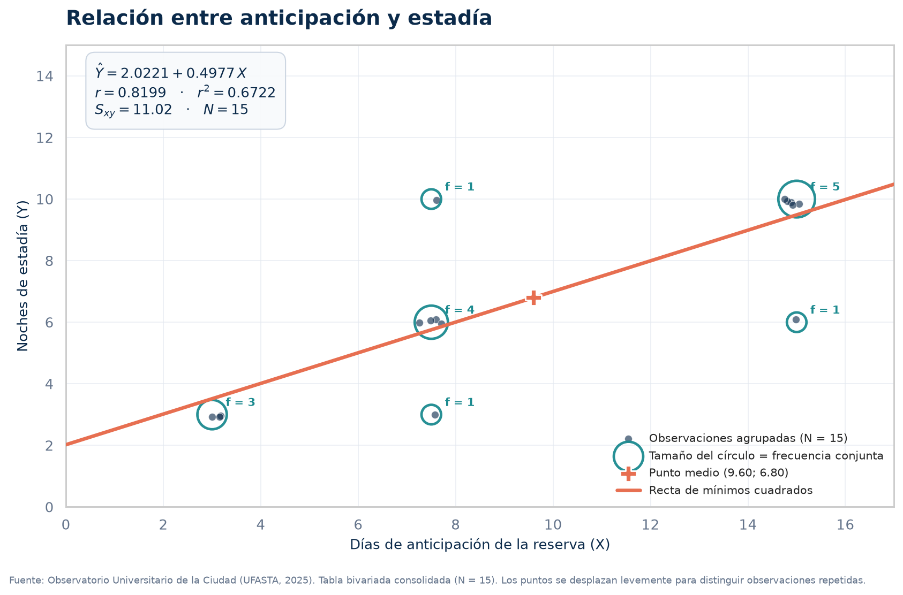

# Desarrollo Turístico Inteligente y Sostenible en el Municipio de General Pueyrredón

## Análisis Estadístico Multianual y Modelo Predictivo (2022–2025)

> **Trabajo Práctico Final Integrador · Estadística · Ciclo Lectivo 2026**  
> Observatorio Turístico de General Pueyrredón · Mar del Plata, Argentina

| Ficha académica | |
| :--- | :--- |
| **Institución** | Instituto Superior de Formación Técnica N°151 (ISFT N°151) |
| **Carrera** | Tecnicatura Superior en Análisis de Sistemas · 2° Año |
| **Espacio curricular** | Estadística |
| **Profesora** | Mascarenhas, María Carolina |
| **Profesor de consulta** | González Ferreira, Gabriel Nicolás |
| **Estudiante** | Saavedra Piñeiro, Jazmín del Rosario |
| **Ciclo lectivo** | 2026 |
| **Entrega** | Noviembre de 2026 |


---

## Índice

1. [Resumen](#1-resumen)
2. [Planteo del problema](#2-planteo-del-problema)
3. [Objetivos](#3-objetivos)
4. [Fuentes de datos y muestra](#4-fuentes-de-datos-y-muestra)
5. [Arquitectura y estructura del repositorio](#5-arquitectura-y-estructura-del-repositorio)
6. [Metodología estadística](#6-metodología-estadística)
7. [Aplicación web](#7-aplicación-web)
8. [Instalación y ejecución](#8-instalación-y-ejecución)
9. [Reproducibilidad y controles](#9-reproducibilidad-y-controles)
10. [Visualizaciones](#10-visualizaciones)
11. [Decisiones metodológicas y limitaciones](#11-decisiones-metodológicas-y-limitaciones)
12. [Publicación en GitHub](#12-publicación-en-github)
13. [Referencias](#13-referencias)
14. [Autoría](#14-autoría)

---

## 1. Resumen

Este proyecto integra los contenidos de estadística descriptiva, probabilidades y regresión lineal simple en una aplicación web desarrollada con **Flask, SQLite, Bootstrap 5 y Chart.js**. El caso de estudio es el turismo receptivo del Municipio de General Pueyrredón (Mar del Plata y zona de influencia) durante el período **2022–2025**.

La aplicación transforma datos abiertos municipales y microdatos calibrados del Observatorio Universitario de la Ciudad (Universidad FASTA) en un tablero reproducible con cuatro recorridos:

- **Procedencia:** evolución de los mercados emisores entre 2022 y 2024.
- **Descriptiva:** tabla de frecuencias agrupadas, medidas de tendencia central, dispersión, cuartiles y box-plot de la estadía.
- **Probabilidades:** tabla de contingencia entre planificación de la reserva y tipo de alojamiento.
- **Regresión:** covarianza, correlación de Pearson, recta de mínimos cuadrados y simulador predictivo de noches de estadía.

Además, expone una **API interna** `POST /predict` que devuelve la estadía estimada para una cantidad de días de anticipación.

---

## 2. Planteo del problema

El Municipio de General Pueyrredón transita un proceso de transformación hacia un **Destino Turístico Inteligente (DTI) y Sostenible**, alineado con el *Plan Integrado de Turismo Sostenible Mar del Plata 2050* y las directrices de la **Red Argentina de Destinos Turísticos Inteligentes (Red DTI-Ar)**.

La incorporación de tecnologías de Big Data, Sistemas de Información Geográfica, sensores de flujo y puntos de interacción mediante códigos QR genera un volumen creciente de datos sobre el perfil, el comportamiento y la movilidad de los visitantes. Sin embargo, esos datos solo se convierten en valor si se organizan, se describen y se modelan con criterios estadísticos.

**Pregunta central:** ¿cómo caracterizar el perfil del turista, estimar la probabilidad de perfiles de reserva y predecir la estadía a partir de los datos del Observatorio Universitario de la Ciudad y de los datos abiertos municipales, para optimizar la gestión de servicios públicos y circuitos turísticos sostenibles?

El proyecto no se limita a describir el fenómeno: construye un **pipeline reproducible** que va del CSV a la base SQLite, de la base a los cálculos estadísticos y de los cálculos a un tablero web con lenguaje visual institucional.

---

## 3. Objetivos

### Objetivo general

Desarrollar un estudio estadístico riguroso e integrador, aplicado a la gestión turística sustentable, que abarque los contenidos de las Unidades 1 y 2 del programa de Estadística.

### Objetivos específicos

1. Analizar la distribución de la estadía en noches mediante tablas de frecuencias agrupadas, medidas de tendencia central, dispersión, cuartiles y box-plot.
2. Evaluar las preferencias de alojamiento y transporte mediante técnicas categóricas y medidas de posición.
3. Modelar la probabilidad de perfiles de viaje (“repentino” vs. “planificado”) y su relación con el alojamiento extrahotelero.
4. Formular un modelo de **regresión lineal simple** entre los días de anticipación de la reserva ($X$) y la duración de la estadía ($Y$), evaluando la covarianza, el coeficiente de correlación de Pearson y el coeficiente de determinación.
5. Implementar una aplicación web que comunique los resultados y permita simular predicciones.

---

## 4. Fuentes de datos y muestra

### 4.1 Datos abiertos municipales: procedencia de los visitantes

Se utilizaron los archivos de procedencia turística publicados por el Municipio de General Pueyrredón para 2022, 2023 y 2024. Los archivos originales se conservan en `data/raw/` para auditoría. Para el análisis se consolidaron los porcentajes mensuales en una apertura anual por grupo de origen y se expresaron sobre una base de referencia de **100.000 visitantes por año**, lo que permite comparar participaciones y volúmenes con cantidades enteras.

| Año | AMBA | CABA | Resto de Buenos Aires | Interior | Exterior | Total |
| :---: | ---: | ---: | ---: | ---: | ---: | ---: |
| 2022 | 39,7 % | 15,4 % | 25,6 % | 19,3 % | 0,0 % | 100.000 |
| 2023 | 39,5 % | 15,2 % | 24,2 % | 19,7 % | 1,3 % | 99.900 |
| 2024 | 35,3 % | 13,1 % | 29,8 % | 21,9 % | 0,0 % | 100.000 |

> **Nota:** el total de 2023 es 99.900 porque los porcentajes originales, al redondearse, no completan exactamente la base de 100.000. La aplicación calcula las participaciones sobre el total efectivo de cada año, de modo que siempre suman 100 %.

**Lectura:** la suma de AMBA y CABA pasa de **55,1 %** en 2022 a **48,4 %** en 2024, una caída de **6,7 puntos porcentuales**. Al mismo tiempo, el Resto de Buenos Aires gana **4,2 pp** y el Interior del país **2,6 pp**. El mercado metropolitano sigue siendo dominante, pero la demanda se diversifica.

### 4.2 Observatorio Universitario de la Ciudad (UFASTA)

El relevamiento del Observatorio Universitario de la Ciudad (Universidad FASTA, informe de verano 2025) aporta el perfil de consumo: edad, estadía, anticipación de la reserva, tipo de alojamiento, medio de transporte y satisfacción.

Para este trabajo se construyó una **muestra sintética reproducible de 100 microdatos** calibrada con los parámetros publicados:

| Indicador | Valor de la muestra | Referencia del informe |
| :--- | ---: | ---: |
| Edad promedio | 36,8 años | 36,8 años |
| Estadía promedio | 5,70 noches | 5,7 noches |
| Anticipación promedio | 7,40 días | 7,4 días |
| Alquiler de depto./casa | 75 registros (75,0 %) | 75,0 % |
| Hotelería | 18 registros (18,0 %) | 18,3 % |
| Alojamiento propio | 7 registros (7,0 %) | 6,7 % |
| Auto particular | 57 registros (57,0 %) | 56,7 % |
| Ómnibus | 30 registros (30,0 %) | 30,0 % |
| Otros medios | 13 registros (13,0 %) | 13,3 % |
| Reservas con menos de 7 días | 17 registros (17,0 %) | 17,3 % |

Las diferencias de una décima son propias de trabajar con 100 registros enteros: los porcentajes del informe original se redondean a la unidad al construir la muestra. La semilla fija `2025` garantiza que cualquier persona que ejecute `scripts/seed_fasta.py` obtenga exactamente los mismos datos.

---

## 5. Arquitectura y estructura del repositorio

```text
turismo/
├── app.py                          # Punto de entrada Flask, rutas y API /predict
├── requirements.txt                # Dependencias de Python
├── .gitignore
├── .gitattributes
├── README.md
├── core/
│   ├── __init__.py
│   └── analytics.py                # Núcleo de consultas y cálculos compartidos
├── scripts/
│   ├── cargar_csv.py               # ETL de los CSV municipales hacia SQLite
│   ├── seed_fasta.py               # Generación calibrada de los 100 microdatos
│   ├── 2_descriptiva.py            # Cálculos descriptivos y gráficos PNG
│   └── 3_regresion.py              # Cálculos de regresión y gráfico PNG
├── db/
│   ├── 1_schema.sql                # Esquema de la base SQLite
│   └── turismo_mdp.db              # Base generada (excluida de Git)
├── docs/
│   └── TP_Final_Estadistica_Turismo_Sostenible.md
├── data/
│   ├── Procedencia_turistas_2022.csv
│   ├── Procedencia_turistas_2023.csv
│   ├── Procedencia_turistas_2024.csv
│   └── raw/                        # Archivos originales del portal municipal
├── static/
│   ├── css/style.css               # Sistema de diseño institucional
│   └── img/
│       ├── boxplot_estadia.png
│       ├── procedencia_comparativa.png
│       └── regresion_lineal.png
└── templates/
    ├── base.html                   # Layout, navegación y pie institucional
    ├── index.html                  # Portada y KPIs
    ├── procedencia.html            # Módulo de procedencia
    ├── descriptiva.html            # Módulo descriptivo y probabilidades
    ├── regresion.html              # Módulo de regresión y simulador
    └── error.html                  # Página de error
```

### Flujo de datos

```text
CSV municipales ──► scripts/cargar_csv.py ──┐
                                            ├──► db/turismo_mdp.db ──► core/analytics.py ──► app.py ──► navegador
scripts/seed_fasta.py ──────────────────────┘                                  │
                                                                               └──► scripts/2_descriptiva.py / scripts/3_regresion.py ──► PNG
```

`core/analytics.py` centraliza la conexión a SQLite y todas las fórmulas. De este modo, los scripts de consola, los gráficos y la aplicación web muestran exactamente los mismos resultados y no hay cálculos duplicados.

---

## 6. Metodología estadística

El trabajo utiliza **dos recortes de datos complementarios**, tal como se presenta en el informe:

- **Módulo descriptivo:** submuestra de control de **N = 50** registros, agrupada en cinco intervalos de clase de amplitud 2.
- **Módulo de regresión:** tabla bivariada consolidada de **N = 15** observaciones, con marcas de clase en $X$ e $Y$.

No se fuerza un único conjunto de datos: cada técnica se aplica sobre la tabla que le corresponde en el informe original.

### 6.1 Estadística descriptiva univariada (N = 50)

#### Tabla de frecuencias agrupadas

| Intervalo | Marca $x_i$ | $f_i$ | $h_i$ | $F_i$ | $f_i x_i$ | $f_i x_i^2$ |
| :---: | ---: | ---: | ---: | ---: | ---: | ---: |
| $[1\,;\,3)$ | 2,0 | 6 | 0,12 | 6 | 12,0 | 24,0 |
| $[3\,;\,5)$ | 4,0 | 14 | 0,28 | 20 | 56,0 | 224,0 |
| $[5\,;\,7)$ | 6,0 | 18 | 0,36 | 38 | 108,0 | 648,0 |
| $[7\,;\,9)$ | 8,0 | 8 | 0,16 | 46 | 64,0 | 512,0 |
| $[9\,;\,11]$ | 10,0 | 4 | 0,08 | 50 | 40,0 | 400,0 |
| **Total** | — | **50** | **1,00** | — | **280,0** | **1.808,0** |

#### Fórmulas aplicadas

Media aritmética:

$$
\bar{x} = \frac{\sum_{i=1}^{m} f_i x_i}{N}
= \frac{280{,}0}{50}
= 5{,}60 \text{ noches}
$$

Mediana por interpolación:

$$
Me = L_{i-1} + \left( \frac{\frac{N}{2} - F_{i-1}}{f_{Me}} \right) \cdot C
= 5 + \left( \frac{25 - 20}{18} \right) \cdot 2
= 5{,}5556 \approx 5{,}56 \text{ noches}
$$

Varianza muestral y desvío estándar:

$$
s^2 = \frac{\sum f_i x_i^2 - \frac{(\sum f_i x_i)^2}{N}}{N - 1}
= \frac{1.808{,}0 - \frac{(280{,}0)^2}{50}}{49}
= \frac{240{,}0}{49}
\approx 4{,}8980
$$

$$
s = \sqrt{s^2} \approx 2{,}2131 \text{ noches}
$$

Coeficiente de variación:

$$
CV = \left( \frac{s}{\bar{x}} \right) \cdot 100
= \left( \frac{2{,}2131}{5{,}60} \right) \cdot 100
\approx 39{,}52\%
$$

Cuartiles:

$$
Q_k = L_{i-1} + \left( \frac{\frac{kN}{4} - F_{i-1}}{f_i} \right) \cdot C
$$

$$
Q_1 = 3 + \left( \frac{12{,}5 - 6}{14} \right) \cdot 2 = 3{,}93
\qquad
Q_3 = 5 + \left( \frac{37{,}5 - 20}{18} \right) \cdot 2 = 6{,}94
$$

$$
IQR = Q_3 - Q_1 = 6{,}94 - 3{,}93 = 3{,}01 \text{ noches}
$$

#### Resultados

| Medida | Valor | Interpretación |
| :--- | ---: | :--- |
| Media | 5,60 noches | Estadía promedio de la submuestra. |
| Mediana | 5,56 noches | El 50 % central se queda hasta 5,56 noches. |
| Moda | 6,0 noches | Clase modal $[5\,;\,7)$, con 18 observaciones. |
| Varianza muestral | 4,8980 noches² | Dispersión absoluta. |
| Desvío estándar | 2,2131 noches | Dispersión en la misma unidad que la variable. |
| Coeficiente de variación | 39,52 % | Alta dispersión (supera el 30 %). |
| $Q_1$ | 3,93 noches | Umbral de escapada corta. |
| $Q_2$ | 5,56 noches | Mediana. |
| $Q_3$ | 6,94 noches | Límite superior de la semana turística estándar. |
| $IQR$ | 3,01 noches | Amplitud del 50 % central. |
| Límites de Tukey | $[-0{,}585\,;\,11{,}455]$ | Sin outliers extremos en la submuestra. |

La distribución presenta un **sesgo positivo leve**: la media (5,60) supera a la mediana (5,56). El coeficiente de variación superior al 30 % confirma una alta heterogeneidad: conviven escapadas cortas y estadías de quince días.

### 6.2 Probabilidades y perfiles de reserva

Se cruzan dos eventos sobre los 100 microdatos:

- $A$: el turista reserva con **menos de 7 días** de anticipación (“repentino”).
- $B$: el turista elige **casa o departamento alquilado**.

| Planificación | $B$: alquila | $B'$: hotel/propio | Total |
| :--- | ---: | ---: | ---: |
| $A$: repentino | 15 | 2 | **17** |
| $A'$: planificado | 60 | 23 | **83** |
| **Total** | **75** | **25** | **100** |

Fórmulas:

$$
P(A \cap B) = \frac{n_{AB}}{N} = \frac{15}{100} = 0{,}15
$$

$$
P(B \mid A) = \frac{P(A \cap B)}{P(A)}
= \frac{0{,}15}{0{,}17}
\approx 0{,}8824 \quad (88{,}24\%)
$$

**Interpretación:** el **88,24 %** de quienes reservan a último momento elige departamentos o casas de alquiler. Este resultado justifica mapas de disponibilidad en tiempo real y promociones digitales de corta duración para el alojamiento extrahotelero.

### 6.3 Estadística bivariada y regresión lineal simple (N = 15)

#### Tabla bivariada de doble entrada

Marcas de clase: $x_1 = 3$, $x_2 = 7{,}5$, $x_3 = 15$; $y_1 = 3$, $y_2 = 6$, $y_3 = 10$.

| $X \setminus Y$ | $y_1 = 3$ | $y_2 = 6$ | $y_3 = 10$ | Total $X$ |
| :---: | ---: | ---: | ---: | ---: |
| $x_1 = 3$ | 3 | 0 | 0 | **3** |
| $x_2 = 7{,}5$ | 1 | 4 | 1 | **6** |
| $x_3 = 15$ | 0 | 1 | 5 | **6** |
| **Total $Y$** | **4** | **5** | **6** | **15** |

Productos cruzados:

$$
\sum_i \sum_j f_{ij} x_i y_j = 1.144{,}50
\qquad
\sum_i f_{x_i} x_i^2 = 1.714{,}50
\qquad
\sum_j f_{y_j} y_j^2 = 816{,}0
$$

#### Medias, varianzas y covarianza

$$
\bar{x} = \frac{3(3) + 6(7{,}5) + 6(15)}{15}
= \frac{144}{15}
= 9{,}60 \text{ días}
$$

$$
\bar{y} = \frac{4(3) + 5(6) + 6(10)}{15}
= \frac{102}{15}
= 6{,}80 \text{ noches}
$$

$$
s_x^2 = \frac{1.714{,}50}{15} - (9{,}60)^2
= 114{,}30 - 92{,}16
= 22{,}14
\qquad
s_x \approx 4{,}7053
$$

$$
s_y^2 = \frac{816{,}0}{15} - (6{,}80)^2
= 54{,}40 - 46{,}24
= 8{,}16
\qquad
s_y \approx 2{,}8566
$$

$$
s_{xy} = \frac{\sum_i \sum_j f_{ij} x_i y_j}{N} - \bar{x}\bar{y}
= \frac{1.144{,}50}{15} - (9{,}60)(6{,}80)
= 76{,}30 - 65{,}28
= 11{,}02
$$

#### Correlación, determinación y recta

$$
r = \frac{s_{xy}}{s_x s_y}
= \frac{11{,}02}{4{,}7053 \cdot 2{,}8566}
= \frac{11{,}02}{13{,}4412}
\approx 0{,}8199
$$

$$
r^2 = (0{,}8199)^2 \approx 0{,}6722 \quad (67{,}22\%)
$$

$$
b = \frac{s_{xy}}{s_x^2}
= \frac{11{,}02}{22{,}14}
\approx 0{,}4977
$$

$$
a = \bar{y} - b\bar{x}
= 6{,}80 - (0{,}4977)(9{,}60)
= 6{,}80 - 4{,}7779
= 2{,}0221
$$

$$
\boxed{\hat{Y} = 2{,}0221 + 0{,}4977 \, X}
$$

**Predicción para 14 días de anticipación:**

$$
\hat{Y} = 2{,}0221 + 0{,}4977(14)
= 2{,}0221 + 6{,}9678
= 8{,}9899 \approx 9 \text{ noches}
$$

**Interpretación:** existe una correlación lineal positiva fuerte ($r = 0{,}8199$). El **67,22 %** de la variabilidad en las noches de estadía se explica linealmente por los días de anticipación. Cada día adicional de anticipación se asocia, en promedio, con **0,4977 noches más** de estadía. El modelo es descriptivo y no debe interpretarse como una relación causal.

---

## 7. Aplicación web

### Rutas

| Método | Ruta | Descripción |
| :---: | :--- | :--- |
| `GET` | `/` | Portada, KPIs, perfil del visitante y arquitectura del pipeline. |
| `GET` | `/procedencia` | Evolución 2022–2024 de los mercados emisores. |
| `GET` | `/descriptiva` | Frecuencias, medidas, box-plot, probabilidades y distribuciones categóricas. |
| `GET` | `/regresion` | Tabla bivariada, cálculo paso a paso, recta y simulador. |
| `POST` | `/predict` | API JSON que estima la estadía para una anticipación dada. |

### API `/predict`

Solicitud:

```bash
curl -X POST http://127.0.0.1:5000/predict \
  -H "Content-Type: application/json" \
  -d "{\"dias_anticipacion\": 14}"
```

Respuesta:

```json
{
  "dias_anticipacion": 14.0,
  "estadia_estimada": 8.9899,
  "estadia_redondeada": 9.0,
  "modelo": "Y = 2.0221 + 0.4977 · X"
}
```

La API valida que el valor sea numérico, finito, no negativo y menor o igual a 365 días. Para el simulador de la interfaz se limita la entrada a 0–30 días.

### Funcionalidades de interfaz

- Diseño **responsive** con Bootstrap 5 y tipografías Inter/Manrope.
- Gráficos interactivos con **Chart.js** (barras, dona y recta de regresión).
- Fórmulas renderizadas con **MathJax**.
- Formato argentino de números: miles con punto y decimales con coma.
- Página de error propia para bases inexistentes, errores SQLite y rutas no encontradas.
- Navegación accesible con enlace “Saltar al contenido”, etiquetas ARIA y foco visible.

---

## 8. Instalación y ejecución

### Requisitos

- Python 3.11 o superior. En Windows, instalarlo desde [python.org](https://www.python.org/downloads/windows/) y marcar la opción **“Add python.exe to PATH”** durante la instalación.
- Git (opcional, para clonar el repositorio).
- Conexión a Internet para cargar Bootstrap, FontAwesome, Chart.js y MathJax desde CDN.

> Todos los comandos se ejecutan desde la **raíz del proyecto**, es decir, la carpeta que contiene `app.py`.

### Windows (PowerShell)

La forma más robusta es llamar directamente al Python del entorno virtual. Así no depende de que el entorno esté activado ni del alias de Microsoft Store:

```powershell
git clone https://github.com/<usuario>/<repositorio>.git
cd turismo

# Solo la primera vez: crear el entorno e instalar dependencias
py -m venv .venv
.\.venv\Scripts\python.exe -m pip install --upgrade pip
.\.venv\Scripts\python.exe -m pip install -r requirements.txt

# Pipeline de datos y servidor
.\.venv\Scripts\python.exe scripts\cargar_csv.py
.\.venv\Scripts\python.exe scripts\seed_fasta.py
.\.venv\Scripts\python.exe scripts\2_descriptiva.py
.\.venv\Scripts\python.exe scripts\3_regresion.py
.\.venv\Scripts\python.exe app.py
```

También podés activar el entorno y usar `python` normalmente:

```powershell
Set-ExecutionPolicy -Scope Process -ExecutionPolicy Bypass
.\.venv\Scripts\Activate.ps1
python app.py
```

> `Set-ExecutionPolicy -Scope Process` solo afecta a esa ventana de PowerShell y evita el error de “la ejecución de scripts está deshabilitada”.

### macOS / Linux

```bash
git clone https://github.com/<usuario>/<repositorio>.git
cd turismo

python3 -m venv .venv
source .venv/bin/activate
python -m pip install -r requirements.txt

python scripts/cargar_csv.py
python scripts/seed_fasta.py
python scripts/2_descriptiva.py
python scripts/3_regresion.py

python app.py
```

> `source .venv/bin/activate` es exclusivo de macOS, Linux y Git Bash. **En PowerShell no existe**: se usa `.\.venv\Scripts\Activate.ps1`.

### Errores frecuentes en Windows

| Síntoma | Causa | Solución |
|---|---|---|
| `python` abre la Microsoft Store | Windows redirige al alias de la Store porque el entorno virtual no está activo | Usar `.\.venv\Scripts\python.exe` o `py` |
| `source` no se reconoce | Es un comando de macOS/Linux, no de PowerShell | Usar `.\.venv\Scripts\Activate.ps1` |
| No se puede cargar `Activate.ps1` por la política de ejecución | PowerShell bloquea scripts | `Set-ExecutionPolicy -Scope Process -ExecutionPolicy Bypass` |
| `py` no se reconoce | No está instalado el lanzador de Python | Reinstalar Python desde python.org o usar `.\.venv\Scripts\python.exe` |
| `ModuleNotFoundError: No module named 'flask'` | Las dependencias se instalaron fuera del entorno | `.\.venv\Scripts\python.exe -m pip install -r requirements.txt` |

Abrir en el navegador: **http://127.0.0.1:5000**

### Orden del pipeline

1. `scripts/cargar_csv.py`: lee `data/Procedencia_turistas_*.csv`, valida columnas y carga la tabla `procedencia_muni`.
2. `scripts/seed_fasta.py`: crea la tabla `encuestas_fasta` y genera los 100 microdatos calibrados.
3. `scripts/2_descriptiva.py`: calcula la tabla de frecuencias, las medidas y genera `boxplot_estadia.png` y `procedencia_comparativa.png`.
4. `scripts/3_regresion.py`: calcula la regresión y genera `regresion_lineal.png`.
5. `app.py`: levanta el servidor Flask.

> Los scripts crean `db/turismo_mdp.db` automáticamente. El archivo está excluido por `.gitignore` porque es un artefacto generado.

---

## 9. Reproducibilidad y controles

La semilla `2025` de `scripts/seed_fasta.py` fija todos los valores aleatorios. Al ejecutar el pipeline se obtienen estos controles:

```text
Edad promedio:          36.80 años
Estadía promedio:        5.70 noches
Anticipación promedio:   7.40 días
Reservas < 7 días:       17 (17.0 %)
Alojamiento:             75 / 18 / 7
Transporte:              57 / 30 / 13
Submuestra de control:   [6, 14, 18, 8, 4]
```

Resultados descriptivos:

```text
Media:                    5.6000
Mediana:                  5.5600
Moda:                     6.0
Varianza muestral:        4.8980
Desvío estándar:          2.2131
Coeficiente de variación: 39.52 %
Q1: 3.9300   Q2: 5.5600   Q3: 6.9400
IQR: 3.0100  Límites: [-0.5850; 11.4550]
```

Resultados de regresión:

```text
Covarianza Sxy:     11.0200
Correlación r:      0.8199
Determinación r²:   0.6722
Pendiente b:        0.4977
Ordenada a:         2.0221
Predicción X = 14:  8.9899 noches
```

### Prueba rápida de la API

Con el servidor en ejecución:

```bash
curl -X POST http://127.0.0.1:5000/predict \
  -H "Content-Type: application/json" \
  -d "{\"dias_anticipacion\": 7}"
```

Resultado esperado: `2.0221 + 0.4977 × 7 = 5.5060` noches.

---

## 10. Visualizaciones

### Box-plot de la estadía



### Procedencia comparativa 2022–2024



### Dispersión y recta de regresión



---

## 11. Decisiones metodológicas y limitaciones

1. **Dos recortes de datos.** El módulo descriptivo usa una submuestra de control de 50 registros agrupados; el módulo de regresión usa la tabla bivariada consolidada de 15 observaciones. Son las tablas que sostienen los resultados publicados en el informe y no deben mezclarse.
2. **Microdatos calibrados.** Los 100 registros de `scripts/seed_fasta.py` son sintéticos y reproducibles. No provienen de una encuesta individual identificable: se generaron para respetar medias, distribuciones y estructura de asociación del informe. La aplicación lo indica en sus notas de fuente.
3. **Datos municipales normalizados.** Los CSV de `data/` contienen una apertura anual por grupo de origen sobre una base de 100.000 visitantes. Los archivos originales del portal se conservan en `data/raw/` para trazabilidad. Las diferencias de redondeo explican que 2023 totalice 99.900.
4. **Varianza muestral vs. poblacional.** El módulo descriptivo usa varianza muestral con denominador $N-1$. La tabla bivariada de regresión usa varianzas y covarianza con denominador $N$, tal como se presenta en el informe.
5. **Redondeo del modelo.** La pendiente se redondea a cuatro decimales antes de calcular la ordenada al origen, para reproducir exactamente $a = 2{,}0221$ y la predicción $8{,}9899$ para $X = 14$. Del mismo modo, los cuartiles se redondean a dos decimales antes de calcular el $IQR = 3{,}01$.
6. **Carácter descriptivo.** La regresión no implica causalidad. La anticipación y la estadía pueden estar mediadas por el tipo de viaje, la distancia, el motivo y el poder adquisitivo, variables que no se controlan en este trabajo.
7. **Muestra acotada.** Los resultados no son inferencias poblacionales formales: no se construyen intervalos de confianza ni pruebas de hipótesis, porque el alcance del trabajo es descriptivo, probabilístico y de modelado lineal.

---

## 12. Publicación en GitHub

El repositorio está preparado para publicarse sin incluir el entorno virtual ni la base generada. Desde la carpeta del proyecto:

```bash
git init -b main
git add .
git commit -m "TP Final Estadística: Observatorio Turístico de General Pueyrredón"
git remote add origin https://github.com/<usuario>/<repositorio>.git
git push -u origin main
```

Si el repositorio remoto ya existe y tiene otro historial:

```bash
git branch -M main
git push -u origin main --force-with-lease
```
---

## 13. Referencias

1. **Observatorio Universitario de la Ciudad – Universidad FASTA (2025).** *Perfil y Comportamiento de los Turistas. Análisis comparativo Temporada de Verano 2022–2025.* Mar del Plata.
2. **Saavedra Piñeiro, Jazmín del Rosario; Gensollen, Bianca; Molteni, Luciano (2024).** *Cuadro Sintético del Análisis Socio-Técnico de un Proyecto de Big Data en el Turismo en Mar del Plata.* ISFT N°151.
3. **Mascarenhas, María Carolina (2026).** *Programa de Contenidos y PPA de la materia Estadística.* Tecnicatura Superior en Análisis de Sistemas, ISFT N°151.
4. **Behar, Roberto y Yepes, Mario (2007).** *Estadística. Un Enfoque Descriptivo.* 3.ª edición. Universidad del Valle, Colombia.
5. **Kelmansky, Diana (2010).** *Estadística para todos.* INET, Ministerio de Educación de la Nación Argentina.
6. **Red Argentina de Destinos Turísticos Inteligentes (Red DTI-Ar) (2023).** *Catálogo de Experiencias en Inteligencia Turística.* 1.ª edición.
7. **Municipio de General Pueyrredón.** *Datos Abiertos – Procedencia de turistas 2022–2024.* Portal de datos abiertos.

---

## 14. Autoría

**Saavedra Piñeiro, Jazmín del Rosario**  
Estudiante de la Tecnicatura Superior en Análisis de Sistemas  
Instituto Superior de Formación Técnica N°151  
General Pueyrredón · Mar del Plata · Argentina

Trabajo presentado para el espacio curricular **Estadística**, a cargo de la profesora **Mascarenhas, María Carolina**, con la colaboración del profesor **González Ferreira, Gabriel Nicolás**. Ciclo lectivo 2026.

---

<p align="center">
  <strong>Observatorio Turístico · General Pueyrredón</strong><br>
  <em>Turismo que se planifica con datos, no con intuición.</em>
</p>
